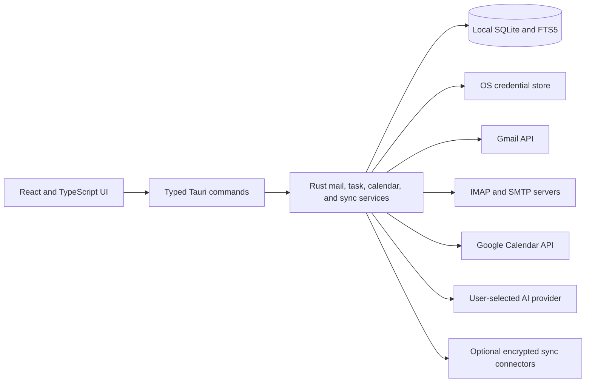

# ThreeStrands product plan

**Status:** Current product baseline and forward-looking roadmap
**Reviewed:** 2026-11-15 against the 0.210.0 repository, current feature guides,
and Notes, Today, sync, and delegated-agent designs. Daily-loop sequencing
revised 2026-11-16.
**Planning decision:** Refresh the baseline and sequence the connected-workflow
additions below as one daily loop. Meeting preparation and follow-through is the
next feature, delivered alongside a first guided daily plan and shutdown in a
reshaped Today. Planned additions are not implemented by this documentation update.

## Product direction

ThreeStrands is a source-available, keyboard-first desktop email client for people
who spend much of their day in their inbox. Its aim is to make important
conversations easy to process while connecting correspondence, notes, tasks,
calendar time, and relationships. The daily workflow should carry context from
preparing for a meeting through recording decisions, completing commitments,
and following up, with control of personal data throughout.

Project licensing is governed by the [PolyForm Perimeter License 1.0.1](LICENSE).
The source can be inspected, built, used, and modified for permitted purposes;
providing others with a competing product built from it is prohibited.

The product is local-first. The desktop app connects directly to Gmail and to
IMAP/SMTP servers; it does not require a ThreeStrands account or an application-operated mail backend.
Mail is cached in SQLite for fast reading, search, and offline work. The mail
provider remains the source of truth for mail. The app stores credentials in the
operating system's credential store and sends mail through a durable local
outbox. Optional AI sends bounded mail context to a provider the user
configures. Optional cross-device sync replicates selected
workflow data through storage the user chooses.

This document distinguishes implemented behavior from future work. “Available”
means present in the repository, with automated coverage; it is not a claim
that every native integration has completed live-account or release
validation. The older phase plans linked below are useful implementation
history, but their milestone labels and uncompleted-item lists are no longer
the product status.

## Current feature set — website draft

This section is written at the level of a future product website. It describes
features in the current desktop app without promising a release date, a
particular platform package, or always-on service behavior.

### Move through mail quickly

- Navigate conversations, messages, accounts, and views from the keyboard.
  Use a command palette and shortcut help to discover actions.
- Read and triage multiple Gmail and IMAP accounts in one merged view, or focus on one
  account. Archive, restore, trash, mark as spam, mark read or unread, star,
  label, and process selected conversations in batches, with undo for
  reversible actions.
- Search the local mail index; when relevant mail is outside the cache, server
  search can bring older results into the local view. Filter the mailbox by
  unread, starred, important, or unanswered conversations.
- Create account-specific Split Inboxes using a sending domain, Gmail label,
  or address pattern. Keep high-volume mail in its own view while the main
  inbox stays focused.
- Save named searches as reusable Split Inboxes tabs with a single-account or
  All accounts scope, Inbox Only, and quick filters. Rename, edit, reorder, or
  delete them together. Saved searches stay on this device and do not route
  mail out of Main.
- Snooze conversations individually or in batches, reschedule them in Snoozed,
  and return them on a new reply or at the selected time while a connected
  installation is running. Reversible changes offer undo.

### Keep the whole conversation moving

- Compose, reply, reply all, and forward with rich text, attachments, and
  reusable snippets. Recipient suggestions come from correspondence history
  and addresses pinned in the composer.
- Drafts save locally and to the account's Drafts on the server, so they
  follow you to other devices and mail apps. A queued send has a ten-second undo window, and the
  durable outbox preserves pending work across restarts. Sent mail is
  reconciled with Gmail when the delivery result is uncertain.
- Send from verified Gmail aliases with per-address signatures and
  alias-preserving server drafts. Schedule a message for later from one fixed
  sending computer; it must be awake, online, and running ThreeStrands, and
  missed times require review. Optional encrypted sync shares delivery summaries
  without transferring sending authority.
- Turn a conversation into an action, follow-up, or waiting-for task; create
  standalone tasks too. Set due dates and repeating follow-ups. Waiting and
  follow-up tasks linked to a conversation can complete when a new reply
  arrives.
- Browse, add, and edit contacts outside the composer, with multiple addresses,
  notes, profile details, correspondence history, groups, birthdays, and Keep in
  Touch reminders. Import and export CSV/vCard address books, explicitly merge
  saved profiles, and reversibly hide addresses from recipient suggestions on
  this device. See [contact management](docs/address-book.md) for merge rules,
  interchange limits, and sync boundaries. A conversation context panel brings
  people, related tasks, and meetings beside the message.
- Read selected macOS address books for names, email addresses, companies, and
  job titles, with refresh and recipient suggestions. Source books stay
  read-only; profiles saved in ThreeStrands remain independent. Direct Google
  Contacts and CardDAV connections remain future work.
- Unsubscribe when a message advertises a supported unsubscribe method, with
  confirmation before the request.

### Bring schedule and assistance into context

- Connect Google Calendar separately from mail. See today's schedule or a
  day, three-day, workweek, or week view, choose visible calendars, preview
  invitations, and check available times against selected calendars and working hours. Put
  selected times into a draft reply. Create events with invitees from the week
  view or a reviewed meeting suggestion, after checking the event dialog.
  Edit events, answer invitations, and find times with guest availability
  where access permits; unknown availability stays explicit. Availability
  profiles support split working hours, account defaults, meeting-type hours,
  and drive-time buffers.
- Book time for an open task by dragging it onto the calendar, initially as a
  30-minute event, or open the event editor to choose a time. The event links
  back to the task; completing the task keeps the calendar event, and deleting
  the event keeps the task. Automatic scheduling and rescheduling are future work.
- Open **Today** for the agenda, free-time and conflict summary, unread mail
  groups, tasks, and Keep in Touch reminders. **You said you would** detects
  possible outstanding promises in recent sent mail locally, without AI; review
  one, turn it into a task, or dismiss it. Goal tracking and period reviews
  already connect tasks to quarterly, half-year, and yearly goals.
- Optionally connect an AI provider with your own API key for thread
  summaries, draft assistance, and suggested tasks or meetings. Suggested
  actions stay proposals until you review them; the app does not create a
  task or send a message from AI output on its own. Thread Chat can answer
  questions with selected readable attachments and explicitly requested mailbox
  search. Contact enrichment suggests profile details from correspondence for
  the user to apply. Proactive briefs require a separate opt-in; enabled briefs
  send qualifying conversations after the reader stays on them. Settings show
  requests, tokens, and estimated costs, with an optional fast model for
  summaries, reply drafts, and contact enrichment.
- Delegate read-only web research in **Agents** after configuring separate
  Anthropic and Exa keys and reviewing public search subjects. Answer clarification
  questions, discuss saved evidence, and explicitly revise reports with retained
  versions and sources. Research has cumulative usage limits and per-task data
  sharing choices; mailbox search, routing, and automatic invitation evaluation
  are not included. A local demonstration works without external requests. See
  [the delegated agents plan](docs/delegated-agents-plan.md).

### Keep notes connected to the work

- Write daily and regular Markdown notes, with wiki links, backlinks, images,
  and attachments. Search titles and text, optionally include Trash, and reopen
  notes from the command palette. Import a Markdown file or folder and export
  to a Markdown folder.
- Link notes to conversations, contacts, tasks, and events; open linked notes
  from those records. Add a conversation to today's note. Round `( )` tasks
  appear in **Tasks** and complete in either place; square `[ ]` checklists stay
  local to their note.
- Add a meeting line to a daily note with links to the event and attendees,
  optionally linking a reusable meeting note. An event with an existing note
  offers **Open Note**. Event details distinguish that occurrence's notes from
  notes for the recurring series.
- **Prepare** for a meeting from Calendar, an agenda, Today, or the command
  palette: its own notes, earlier meetings in its series, recent mail with its
  attendees, and open commitments, read from local data only. Today lists the
  meetings still ahead with what is ready for each, with **Reserve Prep Time** and
  **No Prep Needed**.
- **Review Follow-through** after a meeting: record its decisions and actions,
  as tasks, checklist items, or links to existing tasks, in one of its notes,
  with Undo; the meeting then counts as reviewed on every synced device.
  **Draft Follow-up** opens or resumes one durable draft to the attendees in
  the normal composer. Optional AI assistance remains planned below.

### Stay in control of local data

- Read cached mail and work on drafts while offline. Mail changes and sends
  queue locally and resume when the app can reach Gmail.
- Adjust local mail retention and remote-image loading. Sender HTML is
  sanitized and contained in a sandboxed reader; remote images stay behind
  the native proxy and the chosen image-loading setting.
- Transfer settings, account display metadata, saved contacts, snippets, and
  Split Inboxes with a password-encrypted export. Mail, drafts, queued sends,
  OAuth credentials, and AI keys are excluded; accounts need authorization on
  the new device.
- Inspect sync diagnostics and use opt-in crash reporting. Local database
  backups and startup recovery protect access when the cache is damaged.

**Encrypted sync:** End-to-end encrypted cross-device sync can replicate tasks,
goals, saved contacts and groups, snippets, signatures, Split Inboxes, snooze schedules,
notes, selected preferences, and account display metadata through a shared folder,
S3-compatible storage, or an IPFS connector. Devices
can join with a code, recovery phrase, or approval from another device.
Notes have text-size and attachment limits and explicit conflict resolution;
their attachments travel separately as encrypted objects. Cached mail, mail
attachments, queued sends, and provider credentials stay on each device;
drafts travel through the mail provider. Saved searches remain device-local.
See [cross-device sync](docs/cross-device-sync.md) for the
precise data boundary and connector behavior.

## Product roadmap — website draft

These are directions for unfinished product work, not a dated commitment or
an assertion that a feature is already in beta. Keep this section separate
from the current feature set when publishing a website.

| Direction | What users could expect |
| --- | --- |
| Daily planning, meeting preparation, and follow-through | Start the day with a short guided plan: settle yesterday's unfinished work, choose priorities, get ready for each meeting with its previous notes, correspondence, and commitments, and check the plan against free time. End the day by reviewing meeting decisions, tasks, and follow-up drafts, then carrying, deferring, or dropping what remains. First feature to scope. |
| Capture and relationship context | Capture a thought or task without leaving another app, reuse note templates, and see correspondence, meetings, notes, and logged interactions in a person's history. |
| Realistic capacity and weekly review | Estimate work against available calendar time, distinguish planned days from deadlines, and review the week's unfinished work and goals. |
| Search across the workspace | Find mail, notes, tasks, contacts, and events together, followed by optional answers linked to supporting material. |
| Flexible focus time and assistance | Progress from suggested focus blocks and recurring routines to explicitly authorized rescheduling and reviewed reply preparation. |
| Connected address books | Extend the existing read-only Mac connection where useful; direct CardDAV and Google Contacts connections remain future work. |
| Smarter inbox rules | Explore inspectable, user-controlled classification beyond today's domain, label, and address rules. |
| More mail providers | Harden IMAP/SMTP (design and progress in `docs/imap-design.md`; read, triage, server search, and sending work today), then Microsoft 365. |
| Encrypted sync reliability | Keep hardening optional encrypted sync across devices and app versions, especially upgrades and interrupted joins. |
| Shared and mobile workflows | Explore a mobile companion and shared conversations or drafts where demand justifies the additional architecture. |

The roadmap should be revised as research and reliability work change
priorities. Contact browsing and editing, meeting proposals, available-time
replies, reviewed calendar-event creation and editing, task follow-ups, manual
task time blocking, daily and linked notes, Keep in Touch, and local promise
detection exist today. Snooze, Gmail aliases, read-only Mac Contacts, provider
drafts, and scheduled sending with a fixed sending device are implemented.
The connected-workflow backlog below distinguishes extensions from these
foundations and defines the recommended sequence.

## Competitive feature-gap backlog

Initially assessed 2026-10-31 against the 0.189.1 repository and competitor
documentation. Baseline refreshed 2026-11-15 against 0.210.0, including Notes,
Today, task time blocking, and delegated research. Superhuman, Reflect, Routine,
Reclaim, and Dex product pages were revisited for the connected-workflow additions
below, and Sunsama's daily planning pages were added on 2026-11-16; this is not a
fresh exhaustive audit of every older comparison.
This is an internal planning backlog, separate from the website
roadmap above. It records capability gaps, not measured reliability or usability
deficits. Priorities are proposals for the current individual, Gmail-first Mac
audience; they are not delivery commitments. Update each row as work is scoped
or shipped, and link its implementation issue or design here when one exists.

The existing roadmap already names snooze, Gmail aliases, connected address
books, smarter rules, Microsoft 365, and shared/mobile exploration. This backlog
makes their scope actionable and also captures broader calendar support,
execution while devices are closed, and proactive assistance.

| Gap | Current behavior and missing capability | Proposed next step | Sequence / status |
| --- | --- | --- | --- |
| Conversation snooze | Gmail and IMAP conversations can be snoozed individually or in batches, with rescheduling, undo, new-reply return, and optional encrypted schedule sync. Returns need a running, connected installation. | Complete developer live-account validation alongside the existing release checks. | Implemented in 0.190.0; see [snooze design](docs/snooze-design.md). |
| Gmail sending aliases | Verified aliases, Gmail defaults, addressed replies, per-address signatures, and alias-preserving server drafts are implemented. | Complete developer live-account checks with an alias, including queued and scheduled delivery. | Implemented in 0.191.0; see [Gmail alias design](docs/gmail-aliases-design.md). |
| General rules and richer saved views | Account-specific Split Inboxes match a domain, label, or address pattern. Sender muting archives and marks mail read. Named searches are reusable tabs within Split Inboxes, with shared rename/edit/reorder/delete management, an explicit single-account or All accounts scope, Inbox Only, and quick filters. Existing saved searches appear automatically. Saved views remain device-local and do not route mail out of Main. Compound automation rules remain a gap. | Build on named saved searches: define a first rules contract with explicit conditions and actions, previews, and account scope. Decide whether rules run locally or at the provider. | Saved-search foundation implemented; rule execution still requires scoping. |
| Connected address books | macOS builds read selected system address books for names, email addresses, companies, and job titles, with local caching, automatic refresh, and recipient suggestions. Saved ThreeStrands profiles remain independent. Direct provider connections, Windows/Linux adapters, provider write-back, and richer source fields remain missing. | Validate permission, source selection, refresh, and disconnect in an installed Mac build. Keep Google Contacts API integration deferred during existing OAuth approval. Consider CardDAV and Windows/Linux adapters later; do not request new Google scopes for the current Mac connection. | macOS foundation implemented in 0.192.0; broader integration deferred. See [Mac Contacts design](docs/macos-contacts-design.md). |
| Mobile access and workflow continuity | Desktop encrypted sync already carries Tasks and Notes between installations. | Prove an Android app for Daily Notes, Notes, and Tasks using the existing Rust storage and encrypted sync. The first release starts with local use and pairing through an S3-compatible connector. See the [Android Notes and Tasks implementation plan](docs/android-notes-tasks-plan.md). | Android v1 proposed. iOS and Mail are later work. |
| Microsoft 365 / Exchange | Gmail sign-in and password/app-password IMAP exist; dedicated Microsoft authentication, mail, and calendar integration do not. IMAP is not a substitute for modern authentication or delegation. | Define Microsoft authentication and provider contracts first, then mail and calendar support. Scope delegated/shared mailbox support explicitly rather than assuming basic account support includes it. | Expansion; planned, unscoped. |
| Broader calendar support | Google Calendar supports event editing, invitations, availability, and task time blocking. Microsoft calendars and CalDAV/iCloud connections remain missing. | Define a calendar-provider contract and invitation/availability semantics; prioritize Microsoft with the Microsoft 365 work, then evaluate CalDAV/iCloud. | Expansion; discovery needed. |
| Scheduled sending while devices are closed | Send Later uses one fixed sending computer, which must be awake, online, and running the app; missed times require review. | Evaluate provider-native scheduling or an explicitly authorized execution service. Record the architecture and privacy decision before promising delivery while every device is closed. Preserve uncertain-send reconciliation and duplicate prevention. | Architecture decision required. |
| Proactive assistance and setup friction | Optional summaries, reply drafts, draft review, mailbox-search chat, local promise detection in Today, and reply-completing follow-up tasks already exist. AI requires a user-supplied key. A consolidated commitment queue, prepared replies, and broader classification remain opportunities. | Extend the existing detection and task model through the reviewed reply and commitment queue below; scope richer classification with the rules contract. Assess setup friction separately and preserve explicit data-sharing controls and user review before sending. | Existing foundation; extensions sequenced below. |
| Shared mail workflows | Personal tasks and cross-device sync exist; team comments, collaborative drafts, assignments, shared conversations, and delegated inbox workflows do not. | Validate team demand before designing permissions, shared state, revocation, and collaboration infrastructure. Coordinate delegated mailbox requirements with Microsoft support. | Deferred pending audience decision. |

### Connected-workflow additions

These additions are planned, not available. Priority numbers express product
value; phases below express build order and dependencies. They extend the current
individual workflow while keeping mail reliability and provider hardening active.

**One daily loop.** Meeting preparation, daily planning, and review are parts of
one loop rather than separate features. Plan the morning, which includes getting
ready for the day's meetings; work through the day; then shut down, which includes
meeting follow-through and explicit carry, defer, or drop decisions. A **Prepare**
button that the user has to remember is used less than a planning step that walks
through each meeting. Follow-through belongs at shutdown, when the day's meetings
are over. Calendar and Prepare entry points remain for meetings outside the routine.

**Reshape Today around the loop.** Feedback on the current Today view is that its
agenda and task columns are the valuable parts. The centre unread-mail column,
grouped by addressing heuristics, does not reliably surface important mail and is
low value. Today becomes the home of the daily loop: the day's plan, tasks,
promises, and Keep in Touch reminders as cards beside a one-day calendar view with
meeting readiness, where dragging a card books time for it. Mail shrinks
to a compact, collapsible signal (for example, Invitations and a count of messages
needing a reply, with a path to Inbox) rather than a full column. The
[Today design](docs/today-design.md) records the change. Mail's meaning-based sort
is deferred and no longer drives Today's layout; planning becomes the curated
layer instead.

| Priority / addition | User problem and smallest useful version | Dependencies and boundaries | Success measure to establish during scoping |
| --- | --- | --- | --- |
| 1. Meeting preparation and follow-through | Preparing requires opening several workspaces. Before a meeting, collect occurrence and series notes, relevant cached correspondence, and linked commitments with source links. Afterward, review decisions, proposed tasks, and a follow-up draft based on selected notes and messages. The daily plan's meeting step and the shutdown's follow-through step are its primary entry points. | Reuse event identity, backlinks, contacts, and existing task/draft flows. Begin with local context; AI synthesis is optional and uses explicitly selected material. No recording or transcription dependency. Scope next, with the first daily plan. | Time to prepare for a recurring meeting; share of the day's meetings prepared or explicitly marked as needing no preparation; accepted follow-through actions; duplicate notes or tasks created by repeat use. |
| 2. Daily plan and shutdown | Due dates alone do not describe a realistic day, and nothing prompts the user to decide what today is for. A first guided **Plan Today** routine in Today: settle yesterday's unfinished planned items (carry, defer, or drop), choose priorities from tasks, promises, and Keep in Touch reminders, walk through today's meetings with their readiness and a Prepare action, and compare planned work with free time using existing task time blocking. A matching **Shutdown** lists today's meetings awaiting follow-through and unfinished planned items. Duration estimates and workload warnings follow later. | Extend Today, daily notes, and manual task booking, preserving the existing task and note-task contract. Prefer storing the plan as a section of today's daily note that links existing tasks rather than copying them, so it syncs without a new entity. Reuse availability profiles and buffers; a calendar failure must not appear as free time. Scheduling starts as a reviewed proposal. No plan publishing to chat services. | How often the plan is made; how often planned work fits available time; completion and explicit deferral of selected priorities. |
| 3. Capture from anywhere | Thoughts are lost while switching apps. A system-wide shortcut opens a small window to save a note or task immediately, with optional links to a person, meeting, or conversation. | Reuse durable note/task saves and explicit typing scopes; return focus to the originating app. Source-preserving browser clipping, voice, and mobile capture are later extensions with their own platform contracts. | Time and steps from shortcut to durable capture; successful recovery after interruption. |
| 4. Complete relationship timeline | Context about a person is spread across history and notes. Show emails, meetings, linked notes, completed follow-ups, and manually logged interactions in one chronological view. Let Mark Contacted optionally record what happened and what to discuss next. | Extend Contacts and Keep in Touch with source links, explicit account scope, and cached-history limits. Preserve current reminder semantics until any change is deliberately scoped. No LinkedIn scraping or automatic profile replacement. | Time to find the last meaningful interaction and next commitment; usefulness of due check-ins. |
| 5. Find and ask across the workspace | Users must remember where a fact lives. Start with filtered search across mail, notes, tasks, contacts, and events; then offer optional questions with links to supporting records. | Reuse existing indexes and references, preserve workspace search state, and disclose unavailable or uncached history. Retrieval, bounded AI sharing, and citation validation precede generated answers. | Time to retrieve a known fact; supported answers and clear handling of missing evidence. |
| 6. Protect focus time and recurring routines | Free calendar gaps do not ensure time for important work. Define a weekly focus target and flexible recurring activities, then suggest suitable blocks. | Build on capacity planning, availability profiles, and calendar writes. Start with reviewed placement; later permit rescheduling only for designated flexible blocks, with pinned times, explanations, undo, and explicit execution ownership. | Focus time reserved against the user's target; conflicts and unwanted schedule changes. |
| 7. Reviewed reply and commitment queue | Unanswered mail, promises, waiting-for tasks, and relationship check-ins require separate reviews. Bring them into one actionable queue with source-linked reasons, then offer contextual draft replies for review. | Extend existing promise detection, follow-up completion, Keep in Touch, and planned Today prioritization. Deduplicate overlapping evidence; allow dismissal and correction. Prepared drafts never send automatically. | Missed commitments, duplicate reminders, and useful prepared drafts after user review. |
| 8. Weekly review and planning estimates | The daily plan covers one day; the week's unfinished work and goals still drift. Reusable note templates collect outstanding work, promises, people to contact, goal progress, and upcoming capacity, with explicit carry/defer/drop choices. Add duration estimates and workload warnings to the daily plan once its first version is in use. | Basic daily-note and meeting templates can ship early; populated reviews follow the daily plan and reuse goal-period reviews. Estimates as task data need sync-protocol compatibility, and note tasks cannot carry them today. Save reviews as linked notes; keep square checklists note-local and round tasks aggregated. | Review completion, unresolved commitments carried forward deliberately, and time spent preparing the review. |

Measures are proposed evaluation criteria, not collected telemetry or established
benchmarks. Define a lightweight evaluation during each feature's scoping; any
new telemetry remains a separate, explicit decision.

### Recommended sequence and next feature

1. **First: build the daily loop from existing context.** Interleave meeting
   preparation with a first daily plan and shutdown in a reshaped Today:
   1. Meeting preparation stages 1–2: context contracts, a batch readiness
      summary, and the local preparation view.
   2. **Plan Today**, first version: a guided routine built almost entirely from
      existing Today data, daily notes, and task time blocking, with a meeting
      step that shows readiness and opens preparation. Reshape Today around it,
      reducing the mail column to a compact signal.
   3. Meeting preparation stage 3 and **Shutdown** together: manual
      follow-through and durable drafts, offered at the end of the day for the
      day's meetings, alongside carry/defer/drop of unfinished planned items.
   4. Meeting preparation stages 4–5: privacy prerequisites and optional AI
      synthesis.

   Then add capture from anywhere, relationship history, and reusable daily-note
   and meeting templates. The first workflow must be useful with existing notes,
   contacts, tasks, and cached mail; it does not wait for duration estimates, the
   complete timeline, global search, or a new recording service.
2. **Next: estimate and review deliberately.** Add duration estimates and
   workload warnings to the daily plan, populated weekly reviews, and search
   across the workspace. Extend the [Today design](docs/today-design.md) instead of
   creating competing priority lists; optional AI priority suggestions become a
   step inside Plan Today. Basic search comes before contextual AI answers.
3. **Later: add flexible scheduling and broader assistance.** Introduce focus
   targets and recurring routines through suggestions before authorized
   rescheduling. Build the consolidated reply and commitment queue on existing
   signals, then add prepared replies and sourced cross-workspace answers as
   optional AI. Extend capture to browser and mobile after their data and
   platform boundaries are defined.

The intended end-to-end workflow is: plan the day, see which meetings need
preparation and where you left off with their participants, record decisions in
a linked note, turn commitments into tasks, reserve time to complete them, prepare
the follow-up, and close the day by deciding what carries forward.

For **Plan Today and Shutdown**, the next design should settle:

- Where the plan lives. Prefer a plan section in today's daily note that links
  existing tasks, so it syncs and follows the round-task contract without a new
  entity. A "planned for" date on tasks would need sync-protocol compatibility,
  and note tasks cannot carry one today.
- The smallest routine: which steps are required, which can be skipped, and how
  an unfinished or skipped plan is shown without nagging. Morning and evening
  (plan tomorrow at shutdown) variants.
- How Today's layout changes: what remains of the mail column, how the plan and
  agenda lead, and how the existing keyboard and workspace behavior is preserved.
- Capacity in the first version: free time from the existing day summary minus
  booked task blocks, without estimates or workload warnings. A calendar failure
  must never read as free time.
- Carry/defer/drop semantics for planned items, including note tasks, completed
  items, and items planned on another device.
- Naming: the routine without AI takes the plain **Plan Today** name. The Today
  design's AI **Plan My Day** button becomes an optional step inside the routine.

For **Meeting preparation and follow-through**, the next design should settle:

- Entry points from the daily plan's meeting step, Shutdown, Calendar, and Today,
  the smallest useful local preparation view, relevance and account scope, and how
  the user chooses supporting material.
- A batch readiness summary for a day's meetings that the plan can show without
  loading message or note bodies, and a follow-through state that is the same on
  every device.
- Occurrence versus series context, rescheduled meetings, unrelated events with
  the same title, changed attendees, and unavailable or incomplete cached history.
- A reviewed path from decisions to existing tasks and draft composition, with
  repeat-use duplicate prevention, preserved unsaved notes/drafts, and explicit
  review before any message is sent.
- Optional AI sharing and source attribution, a useful no-AI experience, and
  focused automated coverage plus developer-owned hands-on validation.

This update records the next feature and its scoping questions; it does not
freeze the meeting UX or implement the feature. Delivery dates remain unset.
The proposed [implementation plan](docs/meeting-preparation-design.md) now records
the initial UX and data contracts, delivery stages, compatibility work, and
acceptance coverage. Local preparation comes first, then manual follow-through
and durable drafts, followed by privacy prerequisites and optional AI synthesis.
Its daily-planning entry points, readiness summary, and shutdown follow-through
state are specified there. The [daily planning design](docs/daily-planning-design.md)
specifies the plan's storage in the daily note, carry/defer/drop, and Today's
new layout. Its Plan Today routine and Shut Down evening view were built and then
removed before release (2026-11-18) in favor of a simpler Today.

### Reliability and expansion alongside this sequence

Conversation snooze (0.190.0), Gmail sending aliases (0.191.0), and read-only
macOS Contacts access (0.192.0) are merged. Their remaining live-account and
installed-build checks are validation work, not unimplemented feature gaps.
No new Google OAuth scope is needed to read the Mac's configured address books;
direct Google Contacts integration remains deferred while existing scope
approval is pending. CardDAV and Windows/Linux adapters are future extensions,
not prerequisites for moving on.

Saved searches are implemented as reusable Split Inboxes tabs, with shared
management and explicit account scope. This is a v1 stopping point for saved
views; complete installed-build and live-account validation before broader release.
Settings transfer, cross-device sync, and an explicit Update View action for
temporary search edits remain later improvements.

Scope richer rules separately: agree on conditions, actions, previews,
account scope, execution timing, retries, and undo, including whether rules run
locally or at the provider. Meeting preparation is the next feature focus;
richer rules are a separate backlog item rather than a prerequisite. Continue
mail, IMAP, sync, and release checks alongside the connected-workflow work.
If broader adoption becomes the immediate goal, revisit mobile continuity and
Microsoft 365 as expansion priorities.
Keep shared inboxes, sales pipelines, custom database builders, and meeting
recording infrastructure deferred until audience demand justifies their scope.
Always-on execution and cross-device scheduling ownership require explicit
architecture decisions before promising behavior while every installation is closed.

### Comparison references

The comparison uses [Gmail snooze](https://support.google.com/mail/answer/7622010?hl=en),
[Gmail filters](https://support.google.com/mail/answer/6579?hl=en),
[Gmail sending identities](https://developers.google.com/workspace/gmail/api/reference/rest/v1/users.settings.sendAs),
[Apple Mail rules](https://support.apple.com/en-ae/guide/mail/mlhlp1190/mac),
[Outlook modern authentication](https://learn.microsoft.com/en-us/exchange/clients-and-mobile-in-exchange-online/outlook-for-ios-and-android/setup-with-modern-authentication),
[Outlook shared mailboxes](https://support.microsoft.com/en-us/outlook/sharing/about-shared-mailboxes-shared-folders-and-shared-calendars-in-outlook),
[Spark features](https://sparkmailapp.com/features),
[Superhuman features](https://superhuman.com/plans/mail), and
[Shortwave's assistant and platform support](https://www.shortwave.com/docs/guides/ai-assistant/).
Competitor capabilities can change; recheck relevant references when scoping work.
The connected-workflow recommendations draw on the following current product
pages, reviewed 2026-11-15. These are inspiration sources; the proposed scope and
sequence are ThreeStrands product decisions, not claims of complete feature parity.

| Inspiration | Relevant capability and ThreeStrands direction |
| --- | --- |
| [Superhuman](https://superhuman.com/plans/mail) | Auto Drafts, Auto Reminders, Auto Labels, and Ask AI inform reviewed reply preparation, commitment review, and inspectable classification. |
| [Reflect](https://reflect.app/) | Daily notes, backlinks, web clipping, and answers linked to source notes inform capture and retrieval beyond the Notes foundation already built. The current site distinguishes Reflect Open from Classic. |
| [Routine](https://routine.co/) | Desktop hotkey capture, task/calendar planning, and meeting actions inform capture, capacity planning, and meeting follow-through. |
| [Sunsama](https://www.sunsama.com/daily-planning) | Guided daily planning and [shutdown](https://www.sunsama.com/features/daily-planning-and-shutdown) routines, workload warnings, and explicit carry-over choices inform the daily loop: Plan Today with a meeting-preparation step, and Shutdown with meeting follow-through. Plan publishing to chat services and third-party task imports are not adopted. |
| [Reclaim](https://reclaim.ai/) | Focus protection, flexible recurring habits, and calendar adaptation inform progressive focus scheduling. |
| [Dex](https://getdex.com/) | Relationship context, notes, and keep-in-touch workflows inform a combined history and more useful personal check-ins. |

Our current behavior is documented in the help guides for
[compatibility](site/docs/compatibility.md), [triage](site/docs/triage.md),
[composition](site/docs/compose.md), [contacts](site/docs/contacts.md),
[calendar](site/docs/calendar.md),
[search](site/docs/search.md), [AI](site/docs/ai.md),
[Notes](site/docs/notes.md), [Today](site/docs/today.md), and
[Tasks and Goals](site/docs/tasks-and-goals.md).

## Current product model and decisions

### Audience and scope

The primary user is an individual who wants a fast daily mail workflow across
one or more mail accounts. Notes, tasks, calendar context, relationships, and
optional AI support that workflow. Gmail is the mature adapter, and an
IMAP/SMTP adapter (aimed first at Proton Mail
Bridge) reads, triages, searches, and sends but is still being hardened.

The app does not operate a backend for mailbox access or cross-device sync.
Polling, task reconciliation, queued sends, and replication run while the
desktop app is active and catch up when it starts or resumes. A future feature
that needs execution while all devices are closed requires an explicit new
architecture decision; a scheduled-send UI alone would not provide it.

### Implementation shape

- Tauri 2 hosts the React/Vite interface. The Rust side owns provider calls,
  OAuth, credentials, SQLite, MIME and attachment handling, image fetching,
  and correspondence delivery. The browser development build uses fixtures;
  it does not deliver real mail.
- Gmail sync uses initial import, incremental History cursors, adaptive
  polling, startup/resume catch-up, and recovery when a cursor expires.
  Accounts have separate identities and sync state. Local mail actions use a
  durable mutation queue and reconcile with Gmail.
- Sending uses a separate durable outbox with immutable MIME snapshots,
  cancellation during the undo window, and explicit handling for uncertain
  delivery. Outbox records are local to an installation. Drafts are pushed to and
  pulled from the account's Drafts (Gmail Drafts or the mapped IMAP mailbox),
  never through optional cross-device sync.
- The SQLite cache provides local full-text search, workflow records, and
  periodic backups. Settings include a local mail-retention policy. Provider
  data and application-owned workflow data have deliberately different sync
  boundaries.
- Split Inbox rules currently match a domain, label, or address pattern and
  are scoped to one account; saved-search tabs can instead target one account
  or All accounts and remain device-local. Snippets are shared across accounts locally.
  Tasks can be standalone, linked to a thread, or derived from round tasks in
  saved Markdown notes; square checklists remain note-local. A new inbound reply can
  complete a linked waiting or follow-up task. AI action extraction offers
  reviewable proposals rather than directly mutating tasks or calendar.

### Security and privacy boundaries

- OAuth uses a desktop authorization flow with PKCE. Tokens and optional AI
  keys remain outside the webview and mail database, in the OS credential
  store. The app talks directly to Google and to an AI provider only when
  that integration is configured and used.
- Sender-authored HTML is untrusted. The reader sanitizes unsafe capabilities,
  preserves safe layout, and renders inside a sandboxed, CSP-scoped iframe.
  Remote images use the native proxy and can be blocked. Attachment operations
  stay behind native commands.
- The encrypted settings export contains a versioned, validated allowlist and
  deliberately excludes message content and secrets. Its format is persistent
  across app versions; changes require compatibility handling. See
  [settings transfer](docs/settings-transfer.md).
- Optional replicated sync is off by default and uses a user-chosen connector,
  not a ThreeStrands account. It carries only the application-owned data listed
  in [the sync guide](docs/cross-device-sync.md). Transport providers see
  ciphertext, although file sizes and timing remain visible to them.
- Local mail storage is not described as end-to-end encrypted. Gmail and
  recipients process ordinary email, and someone with access to an unlocked
  local profile may be able to read the cache.

## Work remaining before broader release

1. **Validate the native workflow end to end.** The repository has substantial
   automated unit, integration, and Playwright coverage. The
   [features document](docs/features.md) explicitly leaves live Gmail OAuth, synchronization, sending,
   attachment, and recovery checks to controlled real-account validation.
   Keep those checks as release gates until they are recorded as complete.
2. **Harden the current scope.** Continue testing large mailboxes, provider
   rate limits, offline/reconnect behavior, uncertain send outcomes, database
   recovery, and cross-device sync compatibility. Report progress in user
   terms rather than treating a feature's presence in code as proof of
   production reliability.
3. **Validate implemented features and scope extensions deliberately.** Keep
   installed-build checks for snooze, Gmail aliases, Mac Contacts, provider
   drafts, and scheduled sends, including sleep and shutdown behavior. Exercise
   Notes imports, attachments, concurrent edits, and cross-version sync. Use the
   connected-workflow sequence above for additions, beginning with meeting
   preparation; define ownership and conflicts before extending address books
   or scheduling automation. Mature optional replicated sync before presenting
   it as a standard feature.
4. **Expand integrations from tested contracts.** The Rust provider traits
   isolate Gmail-specific access. Add another provider only with its own
   threading, folder, search, mutation, and send semantics plus contract and
   fault-recovery tests. Keep AI optional and user-reviewed.

## Operating principles

1. Do not lose or duplicate mail or send it unexpectedly. Reconcile uncertain
   outcomes rather than retrying a send blindly.
2. Make common actions fast and keyboard-accessible. Keep typing scopes,
   dialogs, undo, and focus behavior predictable.
3. Treat email, attachment names, provider responses, and AI output as
   untrusted. Preserve safe sender layout without weakening the reader's
   isolation boundary.
4. Keep local, Gmail, AI-provider, and connector data boundaries explicit in
   both the product and its marketing claims.
5. Make offline, reconnect, failed mutation, and recovery states visible and
   repairable. Do not promise always-on execution from a desktop-only app.

## Source documents

- [Co-recipient suggestions plan](docs/archive/co-recipient-suggestions-plan.md) —
  local relationship-aware autocomplete for composing mail and building contact
  groups, including ranking, privacy boundaries, implementation steps, and tests;
  implemented in 0.194.0.
- [Scheduled send plan](docs/scheduled-send-design.md) — fixed sending-device ownership, local scheduling, and encrypted summary visibility across devices; implemented in 0.98.1, with
  Command/Ctrl+Shift+L added in 0.98.2.
- [Design principles](DESIGN.md) — current keyboard, workspace, form, and AI
  review decisions.
- [Cross-device sync](docs/cross-device-sync.md) and [replicated sync design](docs/replicated-sync-design.md) — sync scope and trust model.
- [Settings transfer](docs/settings-transfer.md) and [email rendering policy](docs/email-rendering-policy.md) — persistent-format and reader boundaries.
- [Features and known limitations](docs/features.md) and [contact management](docs/address-book.md) — current capabilities, shortcuts, and outstanding live-account checks.
- [IMAP/SMTP provider design](docs/imap-design.md) — provider design and phase progress.
- [Today view design](docs/today-design.md) — what Today works out without AI, the planned reshaping around daily planning and meeting preparation, and the deferred AI layer.
- [Notes workspace design](docs/notes-design.md) — implemented daily and regular Markdown notes, wiki links, backlinks, attachments, import/export, linked entities, note-derived tasks, and meeting notes; later work remains explicitly separated.
- [Meeting preparation and follow-through](docs/meeting-preparation-design.md) — proposed implementation plan for local preparation, reviewed decisions and actions, durable follow-up drafts, and optional source-backed AI assistance.
- [Daily planning and shutdown](docs/daily-planning-design.md) — the plan stored in the daily note, carry/defer/drop decisions, and Today's reshaped layout; its Plan Today and Shut Down routines were built and then removed before release.
- [Delegated agents plan](docs/delegated-agents-plan.md) — implemented local demonstration and configured read-only web research; later routing and invitation evaluation remain proposed.
- [Archived plans](docs/archive/) — completed plans (multi-account, database recovery, modularization, and layer boundary, Phase 2 compose, IMAP spike, Files workspace) kept for design history.
