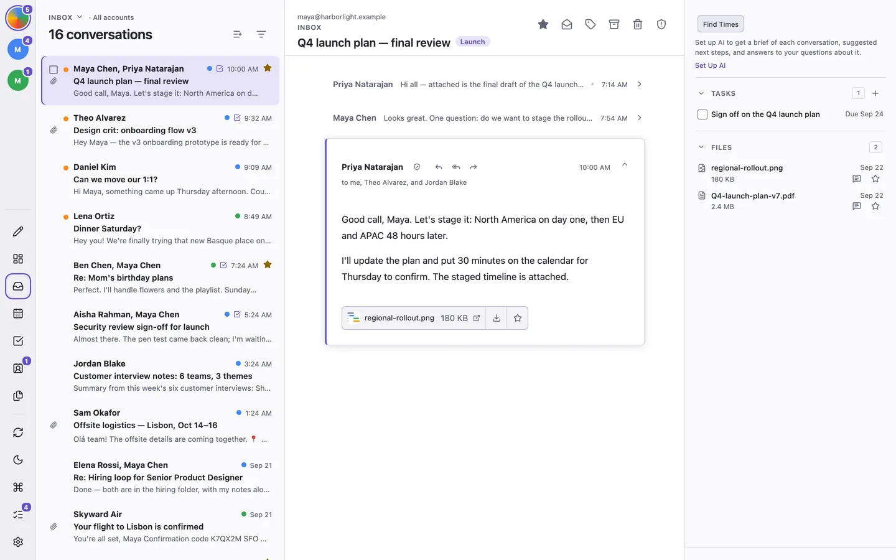

# ThreeStrands

ThreeStrands is a keyboard-first, local-first desktop email client for people
who spend much of their day in email. It brings three strands of work together
in one app (mail, tasks, and your calendar) so follow-ups and scheduling stay
beside the conversation instead of slipping between apps.

ThreeStrands works with Gmail and IMAP/SMTP accounts on macOS and Linux,
including Proton Mail through Proton Mail Bridge. It connects directly to your
providers: there is no ThreeStrands account or server, sign-in credentials stay
in your operating system's keychain, and your messages and search index stay on
your computer.

**Website and docs:** [www.threestrands.app](https://www.threestrands.app)

<picture>
  <source media="(prefers-color-scheme: dark)" srcset="site/src/assets/screenshots/dark/inbox-1440.webp">
  
</picture>

> **Early release.** Only the macOS app is used and tested regularly right now.

## Mail, tasks, and calendar in one place

- **Mail.** Every common action has a shortcut, and a command palette (⌘K) has
  the rest. Triage in batches with undo, split newsletters and other high-volume
  mail into their own tabs, and search all your mail locally, even offline.
  Actions you take offline sync when you reconnect.
- **Tasks.** Turn a conversation into an action, a follow-up, or a
  waiting-for, and link it to a quarterly or yearly goal. A linked follow-up
  completes on its own when the reply arrives.
- **Calendar.** See your day or week from Google Calendar next to your mail,
  answer invitations, and use Find Times to put open slots, based on your
  working hours, into a reply.

Around those three, ThreeStrands also includes:

- **Contacts** with groups, birthdays, and Keep in Touch reminders for people
  you don't want to lose touch with.
- **Files** for browsing every attachment you've sent or received.
- **Trust checks**, run on your computer, that explain suspicious senders,
  links, and attachments.
- **Optional AI** for summaries, reply drafts, thread chat, and draft review.
  It's off until you turn it on, and then it uses your own provider and API key
  with no ThreeStrands server in between.

See [features, keyboard shortcuts, and known limitations](docs/features.md) for
the full list.

## Install

Download the latest installer from
[GitHub Releases](https://github.com/oa-labs/ThreeStrands/releases/latest):

- **macOS:** the `.dmg` for Apple Silicon (`aarch64`) or Intel (`x64`).
- **Linux (x86-64):** a `.deb`, `.rpm`, or `.AppImage` package.

Launch ThreeStrands and add a Gmail account with Google sign-in, or connect an
IMAP/SMTP account in **Settings → Mail Accounts**.

## Product principles

1. Every common action is available from the keyboard.
2. The interface responds immediately, including on unreliable connections.
3. Users can see and control what is synchronized or sent to optional services.
4. Provider-specific behavior is isolated behind a tested capability contract.
5. The desktop client connects directly to mail providers and requires no
   project-operated backend. Optional, end-to-end encrypted cross-device sync
   replicates application-owned workflow data through storage the user
   chooses.

Cross-device sync is described in
[`docs/cross-device-sync.md`](docs/cross-device-sync.md). It never carries
mail, provider credentials, or AI keys.

## Building from source

To build ThreeStrands yourself or contribute, see [`DEVELOPERS.md`](DEVELOPERS.md).

## Independent implementation

ThreeStrands uses its own name, visual identity, product language, and
implementation. It learns from established interaction patterns across the
email category without copying proprietary code, assets, or trademarks.

## License

Copyright © 2026 OpenArc LLC. ThreeStrands is source available under the
[PolyForm Perimeter License 1.0.1](LICENSE).

You can inspect, build, use, and modify the software for permitted purposes,
including personal and internal business use. Copying and redistribution are
allowed subject to the license's conditions, including keeping the license and
required notices. Providing others with a competing product built from this
software is prohibited, even if that product is free.

The source is available so you can inspect how ThreeStrands handles your mail
and credentials. This is a source-available license with a noncompete restriction,
rather than an open-source license. The full text in [LICENSE](LICENSE) controls;
third-party dependencies remain subject to their own licenses. OpenArc LLC may
offer separate licenses for uses outside these terms.
